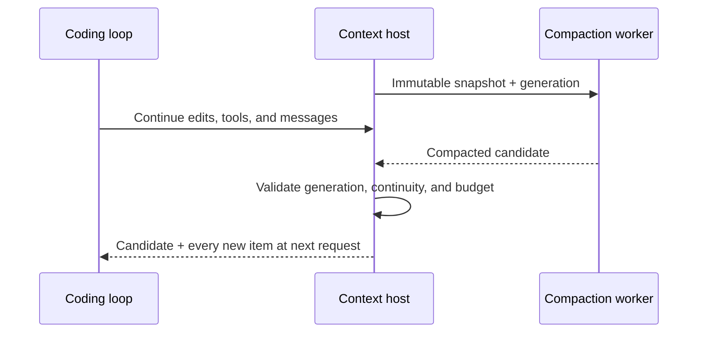

# Ash Context

**Keep the thread. Keep coding.**

[](https://github.com/Ashewj/ash-context/actions/workflows/check.yml)
[](LICENSE)

A focused Agent Skill for long coding sessions: preserve the decisions that matter, condense settled work, and resume with a concrete next action.

## What you get

- **Rolling working memory:** objectives, constraints, changed files, decisions, verification, and next actions.
- **Recent context preserved:** current edits, unresolved errors, user corrections, and pending tools stay intact.
- **256k profile setup:** an optional helper to configure Codex profiles with backups and validation.
- **Async integration design:** snapshot history, prepare compaction in the background, then publish it with every intervening update.

**Current status:** the skill and profile helper are usable today. The [experimental Codex runtime patch](runtime/README.md) implements background preparation and safe transcript replacement, with 12 targeted background tests and two native regression tests passed. It requires a separately built Codex fork; installing the skill does not activate it or change the desktop app. Native fallback can still pause, and compaction under ten seconds is not guaranteed.

## Install

Requires Git and Python 3.11+. The helper uses only the Python standard library.

```sh
git clone https://github.com/Ashewj/ash-context.git
cd ash-context
python scripts/manage_profiles.py --install
```

The default destination is `$CODEX_HOME`, or `~/.codex` when unset. On Windows, use `py` instead of `python` if needed.

For a specific profile:

```sh
python scripts/manage_profiles.py --home /path/to/codex-home --install
```

Restart Codex to discover the installed skill, then invoke:

```text
Use $rolling-context while implementing this task. Preserve my constraints,
current changes, verification results, and next steps across compaction.
```

Ordinary use maintains a session-specific checkpoint at meaningful progress boundaries. The host continues to manage live context compaction.

## Configure 256k context

Preview before changing a profile:

```sh
python scripts/manage_profiles.py --home ~/.codex --window 256000 --disable-post-turn --dry-run
```

Apply to multiple profiles by repeating `--home`:

```sh
python scripts/manage_profiles.py --home /path/to/first-home --home /path/to/second-home --install --window 256000 --disable-post-turn
```

The helper changes only these requested root settings, retains unrelated TOML values and comments, and saves a timestamped config backup before each change:

```toml
model_context_window = 256000
model_post_turn_compact_threshold_percent = 0
```

`--install` installs or updates this skill. Existing skill files that are replaced receive sibling backups. Omitting the configuration flags installs the skill without changing config. Use `--dry-run` to preview either operation without creating files.

### Can this disable native automatic compaction?

**Only turn-end compaction can be disabled by this helper.** In the inspected Codex **0.162.1** source, the main automatic compaction limit is capped at 90% of the context window. At 256,000 tokens that cap is **230,400**. A larger `model_auto_compact_token_limit` is clamped; zero is not an off switch.

The helper explicitly sets turn-end compaction to zero, which is also that version's default. It does not claim to disable the main automatic compaction path. Verify compatibility when using another Codex version; setting a local window does not expand a provider's supported capacity.

See [version-matched model logic](https://github.com/openai/codex/blob/rust-v0.162.1/codex-rs/protocol/src/openai_models.rs) and [turn-end configuration](https://github.com/openai/codex/blob/rust-v0.162.1/codex-rs/core/src/config/mod.rs). The [official configuration reference](https://learn.chatgpt.com/docs/config-file/config-reference) documents context-window and automatic-compaction threshold settings.

## Async architecture



The experimental runtime begins preparing at 50% of the usable context window. It keeps one worker per session, discards stale results, and publishes at a model request boundary. If preparation cannot finish before capacity runs out, it uses native foreground compaction.

Read the [async runtime contract](skills/rolling-context/references/async-contract.md) for the integration requirements and the [runtime verification record](runtime/VERIFICATION.md) for completed checks and limitations. OpenAI's [compaction guide](https://developers.openai.com/api/docs/guides/compaction) describes server-side and standalone API compaction.

## Repository

```text
skills/rolling-context/   Skill instructions and runtime reference
scripts/manage_profiles.py  Install and configure profiles
tests/                   Config preservation and installation checks
runtime/                 Pinned Codex patch, launchers, and verification evidence
```

## Development

```sh
python -m unittest discover -s tests -v
```

Contributions should demonstrate continuity under user steering, pending tool results, or context pressure. Describe whether a change implements runtime behavior or supplies agent guidance. See [CONTRIBUTING.md](CONTRIBUTING.md).

The original skill and profile helper are MIT licensed. The Codex-derived runtime patch and lockfile are supplied under Apache-2.0; see [runtime/LICENSE.codex](runtime/LICENSE.codex) and [runtime/NOTICE.codex](runtime/NOTICE.codex). Repository structure draws inspiration from [Anthropic Skills](https://github.com/anthropics/skills) and [Superpowers](https://github.com/obra/superpowers).
